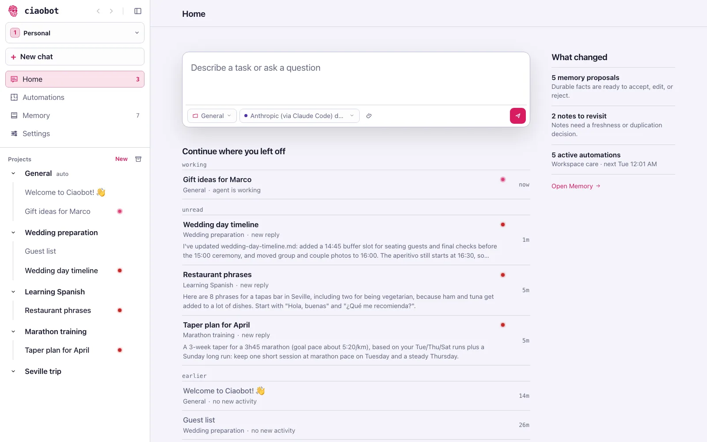

# Ciaobot

<p align="center">
  
</p>

Ciaobot is your **second brain and personal assistant**: a persistent personal workspace for the agents you already use, [Claude Code](https://github.com/anthropics/claude-code) and [OpenCode](https://opencode.ai).

**Your agents do the work. Ciaobot keeps the context.** Claude Code and OpenCode handle models and tools; Ciaobot adds projects, durable memory, files, and recurring tasks so each conversation can build on what came before.

**Change your AI, not your second brain.** Use Claude or OpenCode with a cloud or local model. Your notes, project context, and remembered preferences stay in a folder you own. Durable Markdown knowledge remains useful outside Ciaobot; provider sessions, tools, and permissions are not interchangeable.

## Install

**macOS 13+ on Apple Silicon (M1 or newer):**

```bash
curl -fsSL https://github.com/raffaelefarinaro/ciaobot/releases/latest/download/install.sh | sh
```

Installs the engine with uv, starts it as a LaunchAgent, and opens Ciaobot in your browser already signed in, through a one-time link it also prints. There is nothing to fill in: the installer puts your workspace in `~/Ciaobot`, generates a password and uses Claude Code as the AI tool. The first time you open Ciaobot, Home shows the folder and the password on the computer running it (the password is also `PWA_AUTH_TOKEN` in the folder's `.env`). Change the AI tool in **Settings → Overview** and the password in **Settings → General**.

To use another folder, such as a notes folder you already have, pass `--workspace`:

```bash
curl -fsSL https://github.com/raffaelefarinaro/ciaobot/releases/latest/download/install.sh | sh -s -- --workspace ~/MyNotes
```

The folder stays yours, in plain Markdown, usable with any other tool. Keep it out of iCloud Drive, Dropbox, Google Drive and OneDrive; [Before you start](https://www.raffaelefarinaro.com/ciaobot/guide.html#before-you-start) explains why, and what Ciaobot does with Git in it.

**Windows 11 (x64 or ARM64), preview:**

```powershell
irm https://github.com/raffaelefarinaro/ciaobot/releases/latest/download/install.ps1 | iex
```

No administrator rights needed. It opens Ciaobot signed in, with your workspace in `%USERPROFILE%\Ciaobot` (`-Workspace` picks another folder). See the [Windows guide](docs/WINDOWS.md) for requirements, install options, updates, uninstalling, and troubleshooting.

### Connect your agent

Ciaobot has no model account of its own. It drives a CLI you have already signed in to:

- **Claude:** install [Claude Code](https://docs.anthropic.com/en/docs/claude-code/overview) (`curl -fsSL https://claude.ai/install.sh | bash`) and run `claude auth login`. If its installer says `~/.local/bin` is not in your `PATH`, Ciaobot still finds Claude Code; for the login, run the command it prints or use `~/.local/bin/claude auth login`. On Windows, install it with `irm https://claude.ai/install.ps1 | iex` instead.
- **OpenAI, OpenRouter, Ollama and others:** install [OpenCode 2.0.16+](https://opencode.ai/v2/docs/) (`npm install -g @opencode/cli`; see [INTEGRATIONS.md](INTEGRATIONS.md#opencode) for other routes) and authenticate the provider there. Its models appear in Ciaobot's model picker.

See [INTEGRATIONS.md](INTEGRATIONS.md) for current commands. Contributors running from a git checkout: [docs/DEVELOPMENT.md](docs/DEVELOPMENT.md).

### Existing installs

- **Upgrading from the retired macOS app:** follow the [migration guide](INTEGRATIONS.md#upgrading-from-the-macos-app) to keep your workspace, password, chats, and schedules.
- **Updates:** use **Settings → General** in the PWA. See the [macOS update instructions](INTEGRATIONS.md#upgrading-from-the-macos-app) or [Windows update guide](docs/WINDOWS.md#update-and-rollback).
- **Stop or start the engine:** run `ciao service stop` or `ciao service start`. Your workspace is kept. [Windows service details](docs/WINDOWS.md#how-the-engine-runs).
- **Uninstall on Windows:** follow the [uninstall guide](docs/WINDOWS.md#uninstall). For a leftover legacy macOS app, see the [migration guide](INTEGRATIONS.md#upgrading-from-the-macos-app).

## How it works

Work is organised as **workspace → project → chat**. A workspace is a big area of your life (personal, work, a client) with its own memory; a project holds the background for a topic; a chat is one task. When you finish a chat, archive it and Ciaobot files what is worth keeping into your notes, as plain Markdown in the folder you chose.

<p align="center">
  
</p>

A project can also be linked to a git repository on your machine. Each chat then has a **code mode**, off by default: switched on (by you, or by the agent when you ask to work on the code), the chat follows the repository's `AGENTS.md`, loads its skills and can write in it, while notes and decisions stay in Ciaobot.

Everything you can click, you can also ask for in a chat.

**Full guide, features, memory, models and remote access: [raffaelefarinaro.com/ciaobot](https://www.raffaelefarinaro.com/ciaobot/).**

## Documentation

Start with the [documentation hub](docs/README.md), organised by what you want to do:

- **Using Ciaobot:** first task, projects, memory, files, and automations.
- **Connecting and extending:** providers, Google Workspace, skills, and MCP.
- **Operating Ciaobot:** updates, backups, remote access, and troubleshooting.
- **Building Ciaobot:** architecture, development, API, and agent CLI.

## Why not just use Claude Code or OpenCode?

They are excellent agents. Ciaobot gives them a persistent personal workspace: separate areas of your life, project context carried into each conversation, reviewable memory, scheduled work, and documents you can discuss beside the chat.

| Without a persistent workspace | With Ciaobot |
|---|---|
| Explain the same background in every session | Project context travels with the conversation |
| Useful decisions disappear into chat history | Archived chats can become durable Markdown knowledge |
| Copy outputs between a terminal and documents | Review and annotate files beside the chat |
| Remember to repeat the same prompt every week | Automations run it and leave a result to inspect |

### See what it remembered. Decide what stays.

Archiving a chat can file confident facts automatically; uncertain ones become proposals. Review proposals and recorded decisions in Memory, with Undo where a reversible receipt is available. Nightly curation consolidates existing core memory rather than adding new core facts unattended. Old or unused notes are flagged for your decision, not automatically deleted; retired notes remain restorable until you permanently delete them.

The user-facing product is **Ciaobot**. The CLI is installed as both `ciaobot` and `ciao`; the Python package and many environment variables still use `ciao`/`CIAO_*` for compatibility.

## Built on

Ciaobot builds a persistent personal workspace on excellent open tools: Claude Code, the Claude Agent SDK, OpenCode, Starlette, Vue, and more. See [docs/CREDITS.md](docs/CREDITS.md) for the full list.
