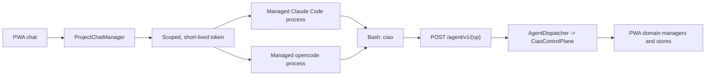

# Ciaobot agent CLI control plane

Since the S6 slice of the CLI-first migration, Ciaobot's own control surface
for the two supported providers, Claude and OpenCode, is a command line:
every operation runs as `ciao <noun> <verb> … --json` inside the managed
provider's shell, described by one skill document
(`ciao/stock/skills/ciao-cli/SKILL.md`). The MCP adapter and `/mcp/` mount are
gone. What remains is the transport-free core the dispatcher needs: the shared
operation table, the bearer-token registry, the plan-mode gate/envelope/
telemetry, and the third-party project MCP server management surfaced by
Settings (which is the agent's *external* tools and is unrelated to Ciaobot's
own surface).

There is no CLI/direct-file fallback and no per-chat surface switch: a chat
whose control plane is unavailable fails the turn with a visible error rather
than running an agent that cannot reach Ciaobot.

## Process and trust model

- **Delivery (D-01).** Ciaobot injects the bearer capability into the managed
  provider's **foreground** shell as `CIAO_AGENT_TOKEN` (with `CIAO_AGENT_URL`
  as the loopback base). This deliberately reverses the old "never in the shell
  env" invariant: CLI-first requires the agent's shell to hold chat authority.
- **Transport.** `ciao` posts `{op, arguments}` to `POST /agent/v1/{op}` with
  `Authorization: Bearer <token>`. `AgentDispatcher` verifies the token with
  `AgentSessionRegistry` (formerly `McpSessionRegistry`), resolves the operation
  from the shared table in `ciao/mcp_server.py`, and runs it through the same
  auth context — so every control-plane guard, the `{ok,data}` envelope,
  argument validation and telemetry are shared. Identity never comes from
  arguments: `--chat` and friends are ordinary parameters authorised by the
  control plane against the token's principal.
- **What the scope enforces, precisely.** The authorization checks are
  *workspace* confinement plus *chat attribution* — not chat isolation. Every
  ownership test terminates in `CiaoControlPlane._workspace`, which compares
  against `principal.workspace`, and `_chat_scope` authorizes any chat through
  the workspace of the project that owns it. So a chat's token can read,
  message, retitle, archive and delete **other chats in the same workspace**; it
  cannot touch another workspace. The chat half of the principal drives the
  plan-mode gate, the child-mode ceiling, revocation
  granularity, and per-chat telemetry — and it lets an operation recognise its
  own chat so it does not tear down its own caller.
- The scope is also not a containment boundary against the model itself. The
  same process holds native Read/Bash/Edit over its workspace root, so the
  control plane is the *convenient* path to Ciaobot state, not the only one.
  `.env` (which holds `PWA_AUTH_TOKEN`), `.runtime/` and `secrets/` are denied
  to the native file tools on both providers — see `credential_path_deny_rules`
  in `ciao/execution_modes.py`, which also states what that deny does not cover
  (the shell).
- A chat whose control plane is unavailable fails the turn:
  `build_agent_request` raises `AgentSurfaceUnavailableError`, which is
  published as a normal failed turn with a logged ERROR. The
  `GET /api/agent/status` endpoint (Settings → Agent CLI) and server logs show
  the cause.
- Plan-mode chats cannot call mutating operations. Results use stable
  `{ok,data}` / `{ok:false,error}` envelopes, and inputs are validated again by
  the domain manager.
- An operation cannot stop its own active turn. Operations that would disconnect
  the caller — current-chat session reset/handover/archive/delete, restart, or
  package update — are queued until that chat is idle.
- Operation telemetry is appended to `.runtime/mcp_tool_calls.jsonl` with
  `surface: "cli"`; provider tool selection is appended to
  `.runtime/agent_tool_calls.jsonl`. Neither file records arguments. A provider
  row carries `control_surface: "cli"` when a shell call's command starts with
  `ciao ` (after whitespace, `cd <dir> &&` hops or `NAME=value` assignments), and
  `"mcp"` for `mcp__ciaobot__*`; other rows omit the key. The archive's per-turn
  `### Tools` section lists each call's input size and error flag, not its input.
- `mcp_tool_calls.jsonl` is size-capped like the job-run log: past ~2 MB it is
  trimmed to the newest 2000 records. Detailed records therefore cover only that
  retained window, but the per-tool counters of everything dropped are rolled
  into `.runtime/mcp_tool_calls_totals.json` first, so the Settings usage table
  keeps reporting lifetime totals. `GET /api/mcp/usage` states the split rather
  than leaving it implied. Telemetry is best-effort in both directions.

## Permission model

There is **no argv auto-approval** in `auto` mode. A `ciao …` shell command is
just another Bash invocation, so `auto` keeps a card on every shell command —
Claude routes it through its classifier and opencode keeps its generic
`bash: ask`. This is deliberate: an argv prefix allow-rule is a security hazard,
because a prompt-injected model could start a Bash input with an allowlisted
prefix (`ciao help >/dev/null; <cmd>`) and the shell suffix would run without a
card. There is no `AGENT_CLI_ALLOW_PATTERNS` / `AGENT_CLI_ASK_PATTERNS` and no
`Bash(ciao …)` allow-list on either provider.

Users who want no cards switch to `bypass`, which grants the full `allow`
wildcard. The server-side floor (mode gates, `unattended_forbidden`, workspace
confinement) remains the real security boundary, independent of the harness
permission rows.

## Managed provider configuration

Users do not maintain a static `.mcp.json` for Ciaobot's own control plane —
there is no Ciaobot MCP server to attach. Every chat is on the CLI surface, so
`ProjectChatManager.build_agent_request` always injects `CIAO_AGENT_URL` and
`CIAO_AGENT_TOKEN` into the foreground shell. The provider's own process is
restarted when the token changes (`provider_reuse_key`).

Separately, Claude Code and OpenCode own their external MCP server configuration
and authentication. Settings → MCP is a read-only native-config inventory plus
live status from already running chats in the selected workspace; it does not
write configuration or credentials, probe a server, or start a provider/MCP
process. Add and authenticate servers through the provider CLI from the
workspace directory (`claude mcp add` / `claude mcp login`, or OpenCode V2's
`opencode mcp add` / `opencode mcp auth`). Every server declared for the
workspace loads; `mcp__<name>` in its `disallowed_tools` blocks one.

Static configuration in an unrelated terminal is intentionally unsupported: the
token is a live chat capability, not an operator credential. Use Ciaobot's
managed Claude Code or opencode process so scope, revocation, deferred
self-actions, and telemetry remain enforced.

## Operation catalog

The operation table in `ciao/mcp_server.py` is the single source the dispatcher
runs; `ciao/stock/skills/ciao-cli/SKILL.md` is the command reference and
`GET /api/agent/status` reports the live operation list. The catalog covers
application actions that are safe and meaningful for a scoped agent:
bounded memory (`ciao memory status|update`), vault (`ciao vault search`,
`ciao vault review …`), projects (`ciao project …`), workspaces
(`ciao workspace list`), chats (`ciao chat …`), schedules (`ciao schedule …`), the task board
(`ciao task …`, including `task delegate` and `task report`), notes
(`ciao note create|related|verify`), webhook triggers (`ciao webhook …`),
Google Workspace (`ciao gws status`), context and Ciaobot's own logs (`ciao context get|logs`), file
surfacing (`ciao file surface`), and the suggested terminal command
(`ciao chat terminal-offer`). Browser-session administration,
login/OAuth secrets, and raw server deploy endpoints remain PWA/operator-only.

That sentence is a summary, not a second catalog: the exhaustive list is the
table, and `ciao/stock/skills/ciao-cli/commands.json` maps every command to the
operation it dispatches. `tests/test_agent_surface.py` pins both directions of
that mapping against the parser, so a verb added to the CLI without a row here
fails rather than quietly becoming a command the telemetry and the behavioral
evals cannot name.

The proposals queue is reviewed and dismissed through the PWA, with one
deliberate CLI exception the nightly curation agent drives because one shell
command beats a synchronous request per row: `ciao memory-proposal-add`,
`ciao memory-proposals`, `ciao memory-proposal-dismiss --text-file <file> [--reason-file <file>]`, and
`ciao memory-proposal-escalate --text-file <file> --reason-file <file>`. For `[memory]`/`[profile]`
rows the run records a verdict with `ciao memory-proposal-predict --text-file <file> --verdict accept|dismiss --reason-file <file>`
and acts on it only as the operator's handover setting allows, through `ciao memory-proposal-dismiss --handover`
and `ciao memory-proposal-accept --text-file <file>`.

The skill-proposal queue has the same pair, for the same reason, and files
rather than dismisses are the interesting half: `ciao skill-proposal-add NAME
--input-file FILE` is how the end-of-conversation memory pass files a supported
skill-improvement proposal, and a person can hand-author one through the same
door. The target is resolved, not trusted — `skills_inventory.resolve_owned_skill`
decides, so a stock copy, a provider mirror, a shared source and an unknown name
are refused by name, and the record carries the resolved path and revision
rather than whatever the caller said. `--input-file` holds a JSON object with
`title`, `problem`, `change`, `rationale` and either a non-empty `sources` list
whose entries carry `chat_id`, `archive`, `turn` and a verbatim `excerpt`, or a
non-empty `origins` list (`learning_id` and `finding`, optionally
`source_revision` and `summary`) for a routed learning: the finding is
conversation prose, so none of it may travel as a shell argument. It proposes
only — `ciao skill-proposal-remove NAME` settles, and a settled record stays
settled while it keeps collecting evidence. It records which outcome it was:
`--applied` when the change landed and was checked (a promotion, so History
reads it as an accept; a proposal that links learning findings also needs
`--verification-file FILE` (a file holding the lines you changed, as you read
them back) with `--applied`), `--interrupted` when the work stopped part-way,
which is neither and leaves the proposal queued with its chat bound to it, and
the plain form for a decision against it. Never record `--applied` for a chat
that simply finished: a turn ending is not a verified edit.

## The suggested terminal command

`ciao chat terminal-offer --command-file FILE` is the one operation whose
argument is *text the model wrote for the user to run*. It records a
suggested command on the calling chat; the user reads it, copies it and runs
it themselves. Nothing is executed, no terminal is opened, nothing is
unlocked, no output is collected, and the operation never reaches the
terminal session manager, the grant store or the host launcher (#1842).

Four properties decide the shape of the surface.

- **No target.** The operation takes the command and nothing else: there is
  no chat id, no label, no kind, no path and no URL. The suggestion belongs
  to the chat that asked for it, and an argument that could aim it elsewhere
  is the one thing that would put a command on a screen the user did not ask
  for. The chat is the token's principal's own, resolved by its **exact** id
  — not by a title, which is a name the caller chose.
- **Guidance, not mutation.** The operation is classified `_READ`, like
  `file surface`, so a plan-mode chat may still offer: the text is reviewed
  by a person before anything runs. An unattended turn (a schedule) is
  refused with `unattended_forbidden` — there is nobody in front of the
  screen to review it. An archived chat is refused with `chat_archived`.
- **Untrusted text.** The command is model-authored and can carry a
  credential or a private path. It is validated by the shared text contract
  (`ciao/terminal_offer.py`): printable text only, bounded at 4096 UTF-8
  bytes, normalized. A refusal is static — `invalid_terminal_command` with a
  closed reason — and never quotes the rejected text, because an error string
  ends up in a log line and in a telemetry field. The argument is a plain
  string so that no schema *constraint* on the text can put a rejected
  command inside a validation error; the engine validates the text itself.
  A malformed *type* is the schema's refusal, and the raw tool error does
  carry the submitted value: what keeps it out of the engine's HTTP
  envelope, its log and its telemetry is the dispatcher, which answers with
  the error's first line only. The raw exception still holds the value, so a
  transport that surfaced it whole would show it. On the CLI the text is
  read from a file with a bound (never as a shell argument, never from a
  credential-adjacent path, and never from anything that is not an ordinary
  file — a FIFO or a device would block the read) and validated locally as
  well.
- **No promise of safety.** The command is untrusted, user-reviewed text.
  Ciaobot does not verify it, does not classify it as safe, and does not
  denylist it. The label on the card is fixed ("Suggested command — review
  before running").

The command is not written to the engine's chat registry, its audit log or a
backup of either: the offer is transient, in memory only, and ends with the
conversation it was made in (archive, new session, handover) or with an
explicit dismissal. A provider's own transcript is the provider's record of
what it was handed, and the engine does not rewrite it — do not rely on the
engine to scrub it. The operation's telemetry row names the operation, the
chat and the outcome — never its argument.

For a provider Ciaobot already supports, its own login or install step
belongs in Settings; an offer is for the commands Settings does not cover.

## Skills and system-prompt policy

The CLI replaces the transport recipes, not behavioural knowledge. Ciaobot's
core prompt tells the agent to use `ciao <noun> <verb>` commands for the
control plane and points at `ciao help` / `ciao <noun> --help` for the command
reference (the command tables live in the `ciao-cli` skill, not in
`ciao/system_prompt.md`, #1464). Provider and
integration skills — Google Workspace, research, document authoring — remain
useful because the CLI does not encode those domain decisions.

## Validation status

The default — and now only — control surface is `cli` for both supported
providers. The MCP-versus-CLI comparison (the S0.5 spike of the migration plan)
measured real-session parity (completion 86%/100% per provider on both
surfaces, zero fallbacks) and drove the D-11 name resolution, D-12 command
table in the core prompt, and the CLI permission posture that make the CLI
surface usable.
